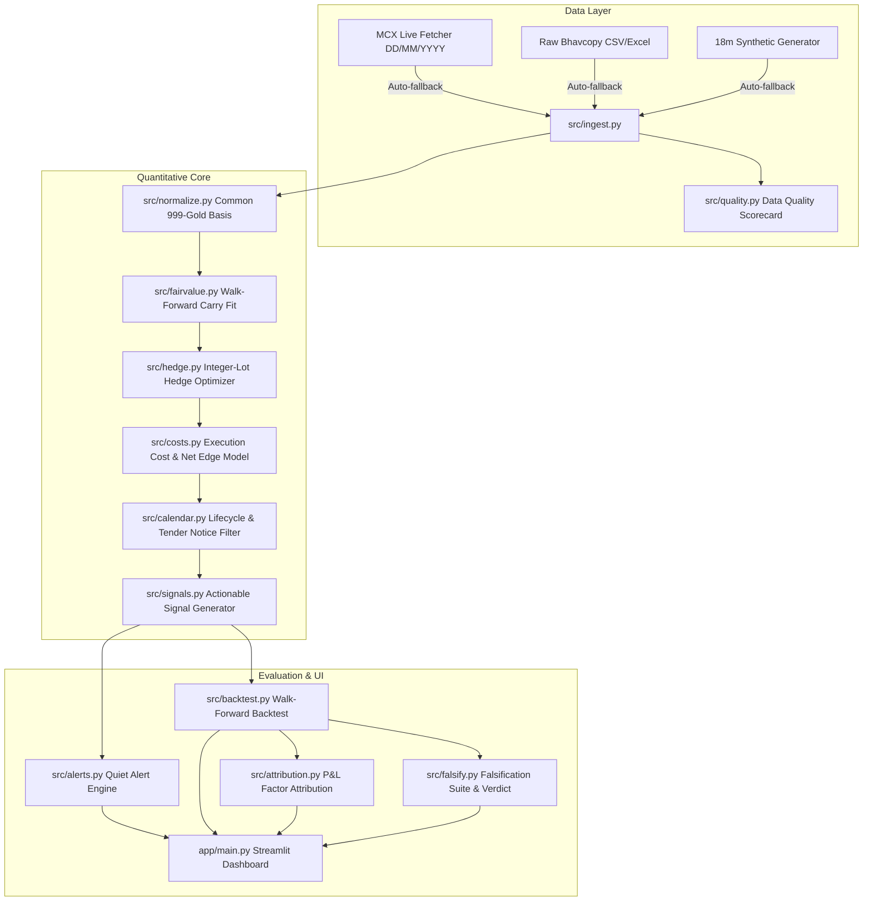

# 🪙 SwarnaScope: MCX Gold Futures Intelligence Lab

> **Defensible Quantitative Relative Value & Carry Intelligence for MCX Gold Futures Contracts**
> Developed for **Hack in Hills '26** — *Problem Statement: Commodity Derivatives Intelligence*.

---

## 📌 Executive Summary

**SwarnaScope** is an honest, production-grade alpha lab designed to compare and trade MCX gold futures contracts representing the exact same underlying metal across different contract specifications:
- **GOLDM** (Gold Mini: 100g lot, 995 purity, quoted per 10g)
- **GOLDTEN** (Gold Ten: 10g lot, 999 purity, quoted per 10g)
- **GOLDGUINEA** (Gold Guinea: 8g lot, 999 purity, quoted per 8g)
- **GOLDPETAL** (Gold Petal: 1g lot, 999 purity, quoted per 1g)

### Core Quant Philosophy
1. **Never call a raw spread a mispricing**: SwarnaScope decomposes observed spreads into carrying cost across expiry gaps ($\Delta T$), purity differentials (995 vs 999), and noise.
2. **Strict No-Look-Ahead**: All parameters, regressions, and rolling Z-scores at trading day $t$ are estimated strictly using information available at $t-1$.
3. **Honest Falsification**: Rigor beats flashiness. SwarnaScope subjects every signal to a 5-part falsification suite (placebo, permutation, bootstrap CIs, Deflated Sharpe Ratio, and cost sensitivity sweeps). Reporting `"No persistent edge after costs"` is a valid, defensible quantitative finding.
4. **Quiet by Default**: The alert engine stays silent (>90-95% suppression rate) when there is no actionable edge after costs.

---

## 🏗️ System Architecture



---

## ⚡ Quickstart

### Prerequisites
- Python 3.11+

### Installation & Execution (One Command)
```bash
pip install -r requirements.txt && streamlit run app/main.py
```

### Run Full Pipeline & Test Verification Script
```bash
python make_demo.py
```

---

## 🧮 Quantitative Methodology

### 1. Common Basis Normalization
Settlement prices are converted into INR per gram of 999-equivalent gold:
$$\text{Price}_{\text{quote\_gram}} = \frac{\text{Close}}{\text{QuoteUnitGrams}}$$
$$\text{NormPrice}_{999} = \text{Price}_{\text{quote\_gram}} \times \text{PurityFactor}$$
*where $\text{PurityFactor} = \frac{999}{995} \approx 1.00402$ for GOLDM.*

### 2. Carry-Adjusted Fair Value
Observed pairwise spread between contract $A$ (expiry $T_A$) and contract $B$ (expiry $T_B$):
$$S_{AB, t} = \text{NormPrice}_{A, t} - \text{NormPrice}_{B, t}$$
Theoretical Carry across expiry gap $\Delta T = T_A - T_B$:
$$\text{TheoreticalCarry}_{AB, t} = P_{\text{gold}, t} \cdot \left( e^{(r + s) \frac{\Delta T}{365}} - 1 \right)$$
Using expanding/rolling window up to $t-1$:
$$\hat{S}_{AB, t} = \hat{\alpha}_{t-1} + \hat{\beta}_{t-1} \cdot \text{TheoreticalCarry}_{AB, t}$$
Residual Mispricing:
$$R_{AB, t} = S_{AB, t} - \hat{S}_{AB, t}$$
$$Z_{AB, t} = \frac{R_{AB, t} - \mu_{R, t-1}}{\sigma_{R, t-1}}$$

### 3. Integer-Lot Hedging
Finds whole lots $(n_A, n_B) \in \mathbb{Z}^+$ minimizing mismatched gram exposure $|n_A L_A - n_B L_B|$.
- **Example**: GOLDM (100g) vs GOLDGUINEA (8g) requires 2 lots vs 25 lots to perfectly match 200g.
- Residual unhedged grams flow into strategy P&L attribution as residual gold beta.

### 4. Cost & Execution Model
Round-trip transaction cost (INR/g):
$$\text{Cost} = \text{BrokerageBps} + \left( \frac{\text{High} - \text{Low}}{\text{Close}} \times \gamma \times \left(1 + \frac{K}{\sqrt{\text{Volume} \cdot \text{OI} + 1}}\right) \right) + \text{SlippageHaircut}$$
$$\text{Net Edge} = |R_{AB, t}| - \text{TotalPairCost}$$
Signal is actionable ONLY if $\text{Net Edge} \ge \text{Safety Margin}$ (default ₹2.0/g).

---

## 🔬 Falsification Suite ("Try to Kill Our Own Signal")

SwarnaScope automatically executes 5 rigorous stress tests:
1. **Placebo Test**: Shuffles date ordering or residual Z-scores randomly.
2. **Permutation Test**: Permutes daily return vector 200 times to calculate p-value of Sharpe ratio.
3. **Bootstrap Confidence Interval**: 1,000 resamples for 95% CI of mean trade P&L and Sharpe.
4. **Multiple-Testing Adjustment**: Deflated Sharpe Ratio (DSR) based on Marcos López de Prado's framework.
5. **Cost-Sensitivity Sweep**: Evaluates performance at 1.0x, 1.5x, 2.0x, and 2.5x base costs.

### Verdict Classifications
- `Edge Survives`: Out-of-sample Sharpe > 0, passes 1.5x costs, permutation p < 0.05.
- `Edge Fragile`: Positive at 1.0x costs but fails at 1.5x costs or p >= 0.05.
- `No Persistent Edge After Costs`: Transaction costs absorb expected reversion profit.

---

## ⚠️ Assumptions, Limitations & Threat-of-Overfitting

1. **Settlement vs Executable Fill**: Official MCX daily Close prices are settlement values, not executable intraday fills.
2. **Order Book Depth**: Volume is not depth. Thin days for GOLDGUINEA / GOLDPETAL can experience slippage.
3. **Non-Gaussian Residual Tails**: Macroeconomic events can produce fat-tailed spread spikes.
4. **Parameter Stability**: Over-tuning Z-score thresholds on historical data risks overfitting noise.

---

## 🧪 Running Unit Tests

```bash
python -m pytest tests/
```
All 12 unit tests verify date validation, normalization math, integer-lot optimization, no-look-ahead invariants, cost models, and attribution P&L identities.
